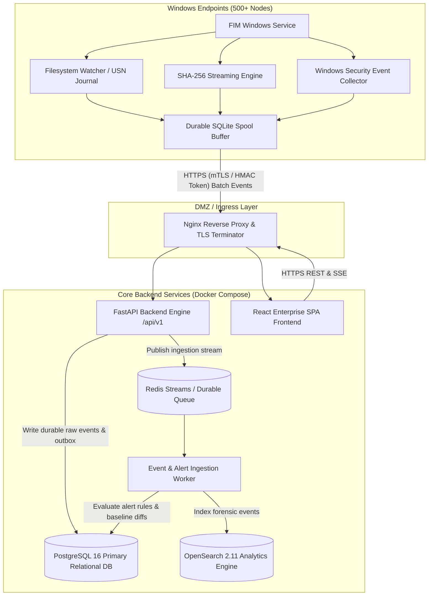

# FIM Enterprise — System Architecture Document

## 1. Architectural Vision & Scope
**FIM Enterprise** is a resilient, self-hosted, distributed File Integrity Monitoring (FIM) platform designed to monitor 500+ Windows client computers and Windows file servers across enterprise environments without reliance on external commercial monitoring agents or cloud services.

The system combines:
1. **Low-latency filesystem watching** (Windows ReadDirectoryChangesW / USN Journal change detection).
2. **Cryptographic SHA-256 integrity verification** and baseline state tracking.
3. **Forensic Windows Security Event Correlation** to link file operations to Windows User Accounts (SID/SamAccountName) based on Event IDs 4663 (Object Access), 4656 (Handle Request), and 4670 (Permissions Change).
4. **Durable, crash-safe local spooling** on endpoints to guarantee zero event loss during network partitions or server maintenance.
5. **High-throughput decoupled ingestion** powered by Redis Streams and asynchronous background workers.
6. **Immutable relational persistence** in PostgreSQL for configuration, baseline records, alerts, and audit trails.
7. **Sub-second search & security analytics** powered by OpenSearch with automatic reindexing pipelines.
8. **Real-time Cyber Defense Web Dashboard** built with React, Vite, Tailwind CSS, AG Grid, and Recharts.

---

## 2. High-Level Component Architecture

---

## 3. Technology Stack & Specifications

| Component | Technology | Version / Spec | Purpose |
| :--- | :--- | :--- | :--- |
| **Frontend** | React 18, TypeScript, Vite, TailwindCSS | React 18, Vite 5, Tailwind 3 | Security analyst interface |
| **Data Grid & Charts** | AG Grid Community, Lucide Icons, Recharts | Latest stable | High-density audit grids & trend visualization |
| **API Backend** | FastAPI, Python 3.12, Pydantic v2 | Python 3.12, FastAPI 0.115+ | High-performance RESTful API & agent ingress |
| **ORM & Migrations** | SQLAlchemy 2.0 (Async), Alembic | SQLAlchemy 2.0.36 | Authoritative persistence & schema versioning |
| **Primary Database** | PostgreSQL | 16-Alpine | Authoritative storage for entities, policies, baselines |
| **Event Bus / Queue** | Redis Streams | Redis 7.2 | Fast buffering with consumer groups and acknowledgments |
| **Search Engine** | OpenSearch | 2.11+ | Forensic event indexing, multi-dimensional search |
| **Windows Agent** | Python / PyWin32 / C-bindings | 3.12 (Freeze to Windows Service) | Endpoint monitoring, SHA-256 calculation, spooling |
| **Reverse Proxy** | Nginx | Alpine | TLS termination, rate limiting, request inspection |

---

## 4. Ingestion Pipeline & Reliability Model

### 4.1 Ingestion Flow
1. **Agent Spooling**: Events generated on the endpoint are committed to an ACID SQLite local database (`spool.db`) before any network dispatch.
2. **Authenticated Batch Ingestion**: The agent batches events (default 50-100 events or 2-second timeout) and submits to `POST /api/v1/agents/events/batch` with its cryptographic token/HMAC header.
3. **API Layer Ingestion**:
   - Validates endpoint identity and active status.
   - Assigns server ingestion UTC timestamp.
   - Inserts records into PostgreSQL `file_events` table (with deduplication on `(endpoint_id, event_id)`).
   - Publishes event ID to Redis Stream `fim:events:incoming`.
   - Returns HTTP 200 with list of acknowledged `event_ids`.
4. **Agent Acknowledgment**: Only after receiving HTTP 200 with matching IDs does the agent purge those events from its local spool.
5. **Worker Processing**:
   - Consumer group `fim-worker-group` reads batches from Redis Stream.
   - Computes baseline state comparisons (detects unauthorized drifts).
   - Evaluates active Alert Rules (ransomware burst detection, executable modification, critical system path tampering).
   - Indexes normalized documents into OpenSearch index `fim-events-YYYY-MM`.
   - Acknowledges Redis message (`XACK`).

---

## 5. User Attribution Architecture (Windows Security Correlation)

Attribution is treated as **forensic evidence correlation**, not a direct filesystem event attribute:
- **Filesystem Watcher**: Detects `file_created`, `file_modified`, `file_deleted`, `file_renamed` with nanosecond precision.
- **Windows Security Event Log**: Watches Security Log channel via `EvtSubscribe` / `ReadEventLog` for:
  - Event ID 4663 (An attempt was made to access an object).
  - Event ID 4656 (A handle to an object was requested).
  - Event ID 4670 (Permissions on an object were changed).
- **Correlator Engine**:
  - Matches `(Path, Normalized Timestamp Window [-2s, +2s], ProcessId / ThreadId)`.
  - Maps `Security ID (SID)` and `Account Name / Domain`.
  - Assigns **Attribution Confidence**:
    - `CONFIRMED`: Exact handle access match with matching process and timestamp within 500ms.
    - `PROBABLE`: Event 4663 on same file path within 2s window.
    - `AMBIGUOUS`: Multiple overlapping accounts touched the object within the time window.
    - `UNKNOWN`: No corresponding security audit record found (e.g., SACL not configured or event overwritten).

---

## 6. Storage & Database Schema Design

Authoritative PostgreSQL database houses 24 relational tables:
1. `users`: Administrative and security analyst accounts (Argon2id passwords).
2. `roles` & `role_permissions`: RBAC permissions (Viewer, Analyst, Admin).
3. `user_sessions`: Active user sessions / JWT refresh tokens.
4. `endpoints`: Managed Windows agents with hardware/OS metadata and health status.
5. `agent_credentials`: Endpoint public keys, API tokens, and rotation records.
6. `agent_checkpoints`: Sequence tracker and USN journal markers.
7. `monitoring_policies`: Versioned policy configurations (paths, scan frequencies, alerts).
8. `monitored_paths`: Path rules, recursion settings, and hash triggers.
9. `policy_exclusions`: Regex, wildcard, and extension exclusions.
10. `endpoint_policy_assignments`: Policy to agent or group bindings.
11. `baseline_scans`: Scan execution metadata and coverage reports.
12. `file_baselines`: Trusted SHA-256 snapshots per endpoint and path.
13. `file_events`: Raw and normalized immutable event log.
14. `security_events`: Correlated Windows Security Audit records.
15. `event_correlations`: Association map between file events and security events.
16. `alert_rules`: User-defined rule engine configurations.
17. `alerts`: Triggered security alerts with severity and status.
18. `alert_events`: Many-to-many relationship linking alerts to source events.
19. `investigation_notes`: Analyst notes and triage timeline.
20. `audit_logs`: Administrative actions log for compliance.
21. `ingestion_outbox`: Outbox for resilient OpenSearch indexing replay.
22. `notification_deliveries`: Webhook and email alert records.
23. `system_settings`: Platform-wide configurations (retention, rate limits).
24. `agent_health_records`: Timeseries heartbeat metrics.

---

## 7. Scaling Model for 500+ Windows Endpoints

- **Heartbeat Interval**: 30 seconds default (jittered by +/- 5s). At 500 agents, ~16 requests/sec into FastAPI.
- **Event Volume**: Typical enterprise Windows endpoint generates ~20–200 integrity-relevant events/hour under targeted policies (excluding noisy temp directories).
- **Peak Burst Capacity**: 5,000 events/second handled via Redis Streams buffer and worker thread pools without database connection starvation.
- **Connection Pooling**: SQLAlchemy Async Engine configured with 50 pool size + 30 overflow, keeping PostgreSQL stable.
- **OpenSearch Partitioning**: Monthly rollover indices with ILM (Index Lifecycle Management) retaining active hot storage for 90 days and warm/cold archival for compliance.
